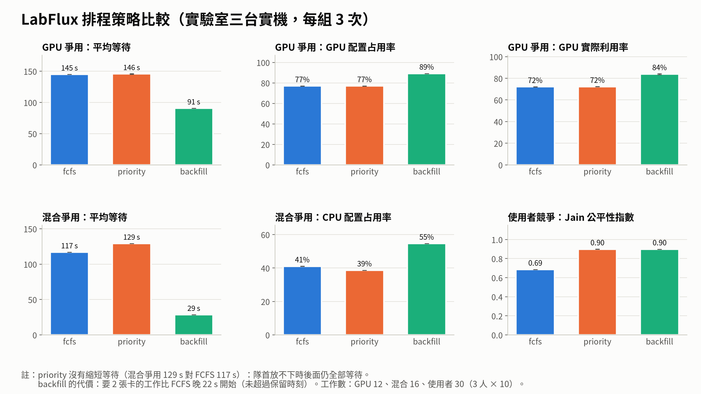

# M13：排程策略的實驗與比較

本文件記錄 M13（`plan.md` 13.1～13.8）的方法、案例、結果、解釋、代價與已知限制，以及重跑方式。
原始資料、CSV 與圖在 `docs/evidence/m13/`，工具在 `scripts/experiments/`，工作負載在 `experiments/workloads/`。

## 摘要

在實驗室三台實機（kayle、karma、kindred）上，以 4 個案例 × 3 種策略 × 3 次（另加 3 次「工作不可搶占」）共 39 輪，
同一份工作負載比較 `fcfs`、`priority`、`backfill`。每組 3 次的結果幾乎相同（標準差多在 1 秒以內），
用真實排程程式碼搭配假時鐘的模擬也與實機相差 1～3%。

| 案例 | 指標 | fcfs | priority | backfill |
|---|---|---|---|---|
| GPU 爭用（12 個 GPU 工作，3 張卡） | 平均等待 | 145 s | 146 s | **91 s（−37%）** |
| | GPU 配置占用率／實際利用率 | 77%／72% | 77%／72% | **89%／84%** |
| CPU／RAM／GPU 混合爭用（16 個工作） | 平均等待 | 117 s | 129 s（變差） | **29 s（−75%）** |
| | CPU 配置占用率／實際利用率 | 41%／33% | 39%／31% | **55%／44%** |
| 使用者競爭（3 人需求相同） | Jain 公平性（每人平均等待） | 0.686 | **0.899** | **0.899** |
| 高優先權插入 | P9 工作等待 | 82 s | **0.3 s**（不可搶占時 28 s） | **0.3 s** |

- **改善來源**：等待時間與占用率的改善來自 backfill（EASY）：大工作放不下而成為隊首時，排程器依執行中工作的硬性
  時限替它保留節點，後面的小工作只要不會延後這個保留時刻，就先放到空著的卡或節點上（`schedule_note`：
  `backfilled on kayle ahead of job g03 reserved on kayle at …; its time limit ends before the reservation`）。
  公平性的改善來自 priority 的近期用量扣分；高優先權的反應來自分數排序加上搶占。
- **代價**：backfill 讓要 2 張卡的工作比 FCFS 晚 22 秒開始（仍未晚於保留時刻，39 輪中沒有一個保留被打破），
  混合案例的 Jain 指數從 0.985 降到 0.795（小工作先跑，大工作的使用者等得比較久）；priority 讓先送出的 alice
  在使用者競爭中多等 27 秒；搶占讓 P9 幾乎不用等，但每輪停掉 alice 的低優先權工作 6 次、浪費 112 秒執行時間、
  makespan 多 56 秒。
- **沒有改善的結果**：priority 沒有縮短任何案例的平均等待，混合案例甚至從 117 秒變成 129 秒（見 6.2）；
  backfill 在使用者競爭與高優先權插入案例和 priority 完全相同（工作大小相同，沒有可以先跑的空隙）。
- **13.7**：叢集滿載時 `labflux run` 取得資源平均 1.4 秒（可搶占）對 56 秒（不可搶占）；自動釋放模型冷啟動
  1.5 秒（假模型，只含 LabFlux 開銷；gemma 真實載入 238～306 秒），閒置 60 秒後被回收、等 GPU 的工作隨即開始；
  Worker 停止 8.6 秒後節點標為 OFFLINE，容器存活的工作被接手且只執行一次，容器遺失的工作在 Worker 回來後重跑。
- 占用實驗室：2026-11-16 09:44～12:40（約 2 小時 56 分），Scheduler 重啟 4 次，每次約 3 秒；結束後還原成正式設定。


## 1. 目的

提案的成功標準：在至少三個異質節點上排程並行工作，並在資源競爭下，呈現比 FCFS 基準更高的資源利用率或更低的
平均等待時間。提案列出的指標：資源利用率、平均等待時間、工作完成時間、使用者之間的公平性、高優先權工作的反應。
M13 用同一份工作負載，分別在 `fcfs`、`priority`（優先權＋等待加分＋近期用量扣分）與 `backfill`（priority 再加
EASY backfilling）三種策略下執行，比較這些指標，並用排程器寫下的 `schedule_note` 說明差異來自哪個行為、付出什麼代價。

## 2. 環境

| 節點 | LabFlux 可配置 | GPU | 實驗可用 |
|---|---|---|---|
| kayle（Scheduler＋Worker） | 16 CPU、48 GiB | RTX 3090、RTX A5000 | 16 CPU、48 GiB、2 張 |
| karma | 16 CPU、24 GiB | RTX 4090 | 16 CPU、24 GiB、1 張 |
| kindred | 32 CPU、64 GiB | 2 × A40 | 24 CPU、16 GiB、0 張（常駐 gemma4-31b 占 8 CPU、48 GiB、2 張 A40） |
| 合計 | | | **56 CPU、88 GiB、3 張 GPU** |

- 實驗室執行 main `8fcab7a` 的程式碼（schema 8）。實驗期間沒有部署，也沒有修改 `src/`。
- 實驗期間只改 kayle 上 Scheduler 的設定檔並重啟 `labflux-scheduler`：在正式設定上加入實驗帳號、自動釋放的
  `m13-fake` 模型，以及 `usage_window_s = 600`，再切換 `scheduling_policy`。三台 Worker 沒有重新部署。
  實驗結束後還原成原本的正式設定（見第 10 節）。
- 占用率的分母是上表「實驗可用」的容量，不含 gemma。

## 3. 方法

### 3.1 工作負載描述（13.1）

每個案例是一個 TOML 檔（`experiments/workloads/<案例>.toml`），每個工作記錄：送出時間 `at`（秒，相對於第一個工作）、
邏輯使用者（alice、bob、carol、dave）、`cpu`、`memory_mib`、`gpu`、選填的 `gpu_model`、硬性時限 `time_limit_s`、
預估時間（預設等於實際執行時間，只用於說明）、`priority`、是否 `preemptible`，以及實際執行多久 `run_s` 與負載種類 `load`。

### 3.2 工作內容

所有工作執行同一支程式 `scripts/experiments/m13_load.py`（以 `python -c` 帶入），執行固定的牆鐘時間：

- `sleep`：只占住配置，不使用資源；用於只看等待時間與占用率的案例。
- `cpu`：開 `ceil(cpu)` 個忙碌程序直到時間到，實際用量由 CPU 配額限制。
- `gpu`：在每張分到的卡上跑 4096×4096 float32 matmul 迴圈（映像 `pytorch/pytorch:2.6.0-cuda12.4-cudnn9-runtime`）。

工作結束時印出 `M13RESULT`，包含容器 cgroup 的 CPU 秒數（`cpu.stat` 的 `usage_usec`）與 matmul 次數，
所以實際 CPU 利用率是逐個工作量測，不受同一台機器上其他人的負載影響。執行時間固定，代表異質節點的速度差不影響
工作長度，只影響工作做了多少（例如 4090 在相同時間內的 matmul 次數約是 A5000 的兩倍）。

### 3.3 重播工具與實驗流程（13.3）

- `scripts/experiments/replay.py` 依 `at` 以各使用者的實驗帳號送出工作。每秒記錄每個工作的狀態與 `schedule_note`
  變化（Scheduler 只保留最新一筆），每 2 秒記錄節點心跳的觀測值（整機 CPU %、可用 RAM、每張卡的 NVML 利用率），
  結束時保存每個工作的所有 attempt 與每個 attempt 日誌裡的 `M13RESULT`。GPU UUID 寫入前就換成「kayle/RTX 3090」這類標籤。
- `scripts/experiments/campaign.py` 對每種策略切換一次 Scheduler，再依序執行每個案例，每個案例重複 3 次。
  每輪開始前確認實驗室是空的：沒有其他使用者的 LabFlux 工作（以唯讀方式查詢 Scheduler 資料庫）、實驗用的三張卡沒有被
  外部程式使用；不空就等待，不取消任何人的工作。
- 公平性分數使用近 `usage_window_s` 秒的用量。為了讓上一輪的用量不影響下一輪，實驗帳號分成 4 組（`m13s1-alice` …
  `m13s4-dave`）輪流使用，同一組至少隔 `usage_window_s`（600 秒）才再使用；每輪不到 5 分鐘，所以輪內的用量全部算得到。
  報告中只顯示邏輯使用者名稱。
- 實驗工作都由實驗帳號送出，環境變數帶 `LABFLUX_EXPERIMENT=m13:<run>:<工作>`，argv 帶 `m13`。

### 3.4 模擬

`scripts/experiments/simulate.py` 用同一份工作負載驅動真正的 `Scheduler` 類別，搭配三個依實驗室容量建立的假 Worker
（kindred 上同樣有常駐 gemma 占兩張 A40）與假時鐘：派送後 1.5 秒回報 STARTED、`run_s` 後回報完成、收到 STOP 後 1 秒
回報終止。輸出格式與實機相同。用途有二：在占用實驗室前先驗證工作落點（排程器以 best fit 選節點，落點常與直覺不同），
以及補上只模擬的案例（cpu、ram、mixed）。模擬沒有誤差來源，所以每個組合只跑一次。

## 4. 指標（13.4、13.5）

| 指標 | 定義 |
|---|---|
| 等待時間 | 送出到第一個 attempt 被派送（資源已預約）。另記到 Worker 回報 STARTED 的時間 |
| turnaround | 送出到最後一個 attempt 結束 |
| bounded slowdown | turnaround ÷ max(實際執行時間, 10 秒)，至少 1 |
| makespan | 第一個工作送出到最後一個工作結束 |
| 配置占用率 | 每個 attempt 預約的 CPU／RAM／GPU × 持有秒數，除以實驗容量 × makespan |
| 實際 CPU 利用率 | 工作 cgroup 的 CPU 秒數總和，同一分母 |
| 實際 GPU 利用率 | 三張實驗用卡在 makespan 內的 NVML 利用率平均（心跳每 2 秒取樣） |
| 公平性 | 需求相同的使用者各自的平均等待，以及 Jain's index＝(Σx)²／(n·Σx²)，1 代表完全相同 |
| 高優先權反應 | P9 工作的等待時間 |
| 互動取得時間 | 叢集滿載時 `labflux run` 到第一行輸出出現的時間 |
| 代價 | 搶占浪費的執行秒數（PREEMPTED attempt 的執行時間）、搶占次數、backfill 是否讓保留的工作晚於保留時刻開始、大工作比 FCFS 晚開始多久 |


## 5. 案例（13.2）

工作執行時間 30～120 秒、硬性時限約為執行時間的 1.5～2 倍、預估時間等於執行時間；除高優先權案例外優先權都是 5、
都不可搶占。每個案例先以模擬確認工作落點（排程器以 best fit 選節點），再在實機執行。

| 案例 | 在哪裡跑 | 工作 | 負載 | 要看的行為 |
|---|---|---|---|---|
| `gpu` | 實機＋模擬 | 12 個 GPU 工作（4 核、8 GiB）：g02 占 kayle 一張卡時，要 2 張卡的 g03（只有 kayle 有兩張）成為隊首；其餘 1 張卡的工作陸續抵達，其中 g08 指定 4090 | matmul | GPU 爭用、head-of-line blocking、backfill |
| `contention` | 實機＋模擬 | 16 個工作：16 核工作占滿 kayle 時，要 2 張卡的 k03 只能等 kayle；之後有 24 核（只有 kindred 放得下）、40 GiB（只有 kayle 放得下）與 2～4 核的小工作 | CPU 跑滿／matmul／sleep | CPU、RAM、GPU 混合與大小工作混合 |
| `users` | 實機＋模擬 | alice、bob、carol 各 10 個相同工作（8 核、4 GiB、45 秒），送出時間錯開 10 秒；叢集一次放得下 7 個 | sleep | 使用者競爭、公平性 |
| `urgent` | 實機＋模擬 | alice 7 個優先權 2、可搶占的工作占滿 7 個位置（執行 60～150 秒）；bob 4 個優先權 5；carol（t=30）與 dave（t=50）各 1 個優先權 9 | sleep | 高優先權插入、搶占與它的代價 |
| `cpu` | 只模擬 | 24 核工作擋在隊首，4 核小工作陸續抵達 | — | 只有 CPU 爭用 |
| `ram` | 只模擬 | 兩個 40 GiB 工作只能放 kayle，4～12 GiB 小工作陸續抵達 | — | 只有 RAM 爭用 |
| `mixed` | 只模擬 | 以種子 13 一次抽出的 24 個工作（平均每 8 秒一個，50% 小、20% 寬 CPU、15% RAM、15% GPU） | — | 非手工設計的混合負載 |

`gpu`、`contention`、`urgent` 是為了重現特定排程行為而設計的案例，所以改善幅度代表「這個行為發生時」的效果，
不是一般工作負載的平均效果；`mixed` 是較中立的檢驗（只模擬）。

## 6. 結果（13.4～13.6、13.8）

實機，每組 3 次，表中為平均值（± 標準差，小於 0.5 不列）。`users`、`urgent` 的工作只 sleep，實際 CPU 利用率為 0。
原始資料在 `docs/evidence/m13/raw/`，彙整在 `summary.csv`。

| 案例 | 策略 | 次數 | 平均等待 s | p50 | p95 | makespan s | CPU 配置 | RAM 配置 | GPU 配置 | CPU 實際 | GPU 實際 | Jain |
|---|---|---|---|---|---|---|---|---|---|---|---|---|
| gpu | fcfs | 3 | 145 | 169 | 216 | 290 | 15% | 19% | 77% | 4% | 72% | 0.974 |
| gpu | priority | 3 | 146 ± 1 | 171 | 221 ± 5 | 290 | 15% | 19% | 77% | 4% | 72% | 0.994 |
| gpu | backfill | 3 | 91 | 94 | 176 | 250 | 17% | 22% | 89% | 4% | 84 ± 1% | 0.963 |
| contention | fcfs | 3 | 117 | 129 | 159 | 243 | 41% | 26% | 35% | 33% | 32% | 0.985 |
| contention | priority | 3 | 129 | 150 | 171 | 258 | 39% | 24% | 33% | 31% | 30% | 0.998 |
| contention | backfill | 3 | 29 | 15 | 105 | 182 | 55% | 34% | 47% | 44% | 43% | 0.795 |
| users | fcfs | 3 | 65 | 77 | 140 | 227 | 86% | 27% | 0% | 0% | 0% | 0.686 |
| users | priority | 3 | 65 | 71 | 146 | 227 | 86% | 27% | 0% | 0% | 0% | 0.899 |
| users | backfill | 3 | 65 | 71 | 146 | 227 | 86% | 27% | 0% | 0% | 0% | 0.899 |
| urgent | fcfs | 3 | 35 | 0 | 93 | 168 | 89% | 28% | 0% | 0% | 0% | 1.000 |
| urgent | priority | 3 | 0 | 0 | 0 | 224 | 74% | 24% | 0% | 0% | 0% | 1.000 |
| urgent | backfill | 3 | 0 | 0 | 1 | 224 | 74% | 24% | 0% | 0% | 0% | 1.000 |

圖：`figures/summary_16x9.png`（簡報用）、`figures/mean_wait.png`、`figures/utilization.png`、`figures/fairness.png`、
`figures/urgent.png`，以及每個案例、每種策略第 1 次的時間軸 `figures/gantt_<案例>_<策略>.png`。



### 6.1 GPU 爭用：backfill 把等待縮短 37%，GPU 占用率從 77% 提高到 89%

FCFS 下，g02 在 kayle 的 A5000 上跑到 122 秒，要 2 張卡的 g03 成為隊首；之後的工作全部排在它後面
（`fcfs: submission #144; waiting behind job g03`），所以 kayle 的 3090 從 0 到 122 秒、karma 的 4090 從 91 到
122 秒都空著（`figures/gantt_gpu_fcfs.png`）。

backfill 下，g03 依 g02 的硬性時限取得 kayle 的保留時段（`reserved on kayle at 11:41:15`），時限在那之前結束的
1 張卡工作先放上空著的 3090 與 4090（`backfilled on kayle ahead of job g03 reserved on kayle at 11:41:15; its time
limit ends before the reservation`），每輪 5 個。時限會超過保留時刻的則留在佇列
（`its 60s time limit would delay job g03 reserved on kayle …`）。

**代價**：g03 在 FCFS 下 122 秒開始，backfill 下 144 秒。EASY 只保證隊首不晚於「依硬性時限算出的」保留時刻
（約 181 秒），不保證它跟 FCFS 一樣早：g02 實際上比時限早結束，但 3090 已經被先跑的工作占用。39 輪中沒有任何工作
晚於它被保留的時刻才開始。

priority 與 FCFS 幾乎相同：所有工作優先權相同、等待加分接近，隊首被擋住時後面一樣全部等待；只有每人等待較平均
（Jain 0.974 → 0.994）。

### 6.2 混合爭用：backfill 縮短 75%；priority 反而變差

backfill：每輪 12 個工作先跑。例如 24 核的 k07 在 15 秒就放上空著的 kindred
（`backfilled on kindred ahead of job k03 reserved on kayle …; the reserved job waits for kayle`），FCFS 下要等到 122 秒；
40 GiB 的 k09 也從 182 秒提前到 122 秒。CPU 配置占用率 41% → 55%，cgroup 量到的實際 CPU 利用率 33% → 44%。
**代價**：Jain 0.985 → 0.795。carol 的工作多是要 2 張卡或 40 GiB 的大工作，只能等 kayle，平均等 50 秒，
alice 與 bob 的小工作只等 17～20 秒。

**priority 沒有改善（117 → 129 秒）**：122 秒時 carol 的 k09（40 GiB，近期用量 0）分數最高，成為隊首
（`priority: first in line (score 502 = priority 5, waited 2 min, recent usage 0 min); waiting for matching CPU/RAM/GPU
capacity`），但只有 kayle 放得下 40 GiB，要等到 182 秒 k03 結束。priority 沒有 backfill，隊首放不下時後面全部等待，
karma 與 kindred 的空位因此閒置；FCFS 的提交順序剛好讓 k07 先拿到 kindred。重新排序本身不會減少空轉，
要搭配 backfill 才會。

### 6.3 使用者競爭：公平性從 0.686 提高到 0.899，平均等待不變

| 策略 | alice 平均等待 s | bob | carol | 全體平均 | Jain |
|---|---|---|---|---|---|
| fcfs | 13 | 63 | 121 | 65 | 0.686 |
| priority | 40 | 63 | 93 | 65 | 0.899 |
| backfill | 40 | 63 | 93 | 65 | 0.899 |

三人需求相同，只是 alice 早 10 秒、bob 早 10 秒送出。FCFS 下 alice 的 10 個工作先占滿第一輪，carol 平均等 121 秒。
priority 下 alice 的工作執行後累積近期用量被扣分，第二輪起 bob、carol 的工作排到前面
（例如 `started on karma (score 501 = priority 5, waited 1 min, recent usage 0 min)`）。工作量相同，所以全體平均等待
不變，**代價**是 alice 從 13 秒變成 40 秒。backfill 與 priority 相同：工作大小相同，沒有可以先跑的空隙。

### 6.4 高優先權插入：搶占讓 P9 幾乎不用等，代價是浪費的執行時間

| 設定 | P9 平均等待 s | bob（P5）平均等待 s | alice（P2）平均 turnaround s | 搶占次數 | 浪費的執行秒數 | makespan s | CPU 配置 |
|---|---|---|---|---|---|---|---|
| fcfs | 81.8 | 73 | 106 | 0 | 0 | 168 | 89% |
| priority，工作不可搶占 | 28.1 | 88 | 106 | 0 | 0 | 168 | 89% |
| priority，可搶占 | 0.3 | 0 | 163 | 6 | 112 ± 1 | 224 | 74% |
| backfill，可搶占 | 0.3 | 1 | 163 | 6 | 112 | 224 | 74% |

- FCFS：P9 排在 bob 的 4 個 P5 後面，平均等 82 秒。
- priority、工作不可搶占：P9 排到最前面（`started on kayle (score 900 = priority 9 …)`），等第一個空出來的位置，28 秒；
  代價由 bob 承擔（73 → 88 秒）。
- priority、可搶占：P9 送出時立刻停掉 alice 最晚開始、損失最少的工作（`preempted by job …; queued to run again
  (preemption 1 of 3)`），0.3 秒內取得資源。但 bob 的 P5 也嚴格高於 alice 的 P2，同樣可以搶占，所以每輪共搶占 6 次
  （bob 4 次、carol 與 dave 各 1 次）。**代價**：浪費 112 秒執行時間，alice 的平均 turnaround 106 → 163 秒，makespan
  168 → 224 秒，CPU 配置占用率 89% → 74%（停止、重新排隊與重跑之間的空檔）。
- 「工作不可搶占」那一列是 13.7 的搶占關閉對照，見 7.1。

### 6.5 只模擬的案例（cpu、ram、mixed）

用真實排程程式碼、假 Worker 與假時鐘執行（`docs/evidence/m13/sim/`，`figures/sim_mean_wait.png`）。實機也有跑的四個案例，
模擬與實機的平均等待相差 1～3%（模擬假設容器 1.5 秒啟動，實機較快）。

| 案例 | 策略 | 平均等待 s | makespan s | 主要資源配置占用率 | Jain |
|---|---|---|---|---|---|
| cpu | fcfs | 63 | 184 | CPU 66% | 0.996 |
| cpu | priority | 63 | 170 | CPU 72% | 0.976 |
| cpu | backfill | 20 | 174 | CPU 70% | 0.763 |
| ram | fcfs | 74 | 200 | RAM 61% | 0.971 |
| ram | priority | 69 | 170 | RAM 71% | 0.990 |
| ram | backfill | 21 | 154 | RAM 79% | 0.608 |
| mixed | fcfs | 106 | 478 | CPU 46%、GPU 15% | 0.943 |
| mixed | priority | 102 | 478 | CPU 46%、GPU 15% | 0.955 |
| mixed | backfill | 34 | 377 | CPU 59%、GPU 19% | 0.803 |

亂數產生的 `mixed` 也呈現同樣的方向：backfill 把平均等待從 106 秒縮短到 34 秒、makespan 從 478 秒縮短到 377 秒，
代價同樣是公平性下降（大工作的使用者等得較久）。`cpu` 案例中 backfill 的 makespan（174 秒）略長於 priority（170 秒）：
先跑的小工作讓 24 核工作晚開始，總完成時間不一定縮短。

## 7. 其他影響（13.5、13.7）

在 backfill 設定下執行（`scripts/experiments/probes.py`，資料在 `docs/evidence/m13/raw/probes/`）。

### 7.1 搶占開關與互動工作的取得時間

叢集被 alice 7 個 8 核工作占滿後，以 dave 執行 `labflux run -- python -c "print('m13-ready')"`，量到第一行輸出出現
（session 1 核、256 MiB）。

| 占滿叢集的工作 | 次數 | 冷：第一行輸出 s | 熱：同一 session 第二個指令 s | 被搶占的工作 |
|---|---|---|---|---|
| 可搶占 | 3 | 1.4（1.4–1.4） | 0.36 | 每次停 1 個，損失 3 秒 |
| 不可搶占 | 3 | 56.0（56.0–56.1） | 0.24 | 無 |

互動工作在所有策略下都能搶占可搶占的批次工作（M11 11.4），所以取得時間從「等第一個工作結束」（56 秒）縮短到
1.4 秒，其中包含確認被搶占的容器停止、啟動 session 容器與送出快照。搶占的開關以「工作是否可搶占」比較，
未另外重啟 Scheduler 設 `preemption_enabled = false`：搶占只會停掉標記為可搶占的工作，對這些案例兩者效果相同。
高優先權批次工作的對照見 6.4（P9：0.3 秒對 28 秒）。

### 7.2 模型冷／熱啟動與閒置回收

`m13-fake` 是 `examples/fake-model` 的 CPU 假模型（自動釋放、1 核、512 MiB、以 GPU 篩選固定在 karma 的 4090，
只占卡不使用），經 Gateway 送 `/v1/chat/completions`。

| 情況 | 次數 | 冷啟動請求 s | 熱請求平均／最大 s | 等 4090 的工作等待 s | 模型閒置到被回收 s |
|---|---|---|---|---|---|
| 4090 空著 | 3 | 1.55 | 0.028／0.068 | 60.4 | 60.5 |
| 4090 被可搶占工作占用 | 1 | 2.05 | 0.015／0.024 | 60.5 | 60.5 |

- 冷啟動 1.5 秒只包含 LabFlux 的開銷（排程、容器啟動、健康檢查通過才導流）；狀態依序為 stopped → waiting → starting
  → serving。真實模型還要加上載入時間：gemma4-31b 在 kindred 兩張 A40 上冷啟動 306 秒、常駐模式自行啟動 238 秒
  （`docs/verification.md` 10.10）。
- 4090 被占用時，模型啟動搶占了那個工作（執行 3.6 秒即被停掉，之後重跑完成），冷啟動多 0.5 秒。
- 閒置回收：模型最後一個請求結束後，有工作在等 4090，閒置約 60 秒（`reclaim_idle_s`）模型就被停止，工作隨即派送；
  沒有工作在等時要閒置 300 秒（`idle_stop_s`）才停止。代價是下一個請求要再冷啟動一次。

### 7.3 Worker 故障（karma）

karma 上有一個可重跑的 8 核工作（w-cpu）與一個 4090 工作（w-gpu）。執行 20 秒後停止 karma 的 Worker，
karma OFFLINE 後刪除 w-cpu 的容器（模擬整台當機），再送出一個也要 4090 的工作（w-late），30 秒後啟動 Worker。

- Worker 停止後 8.6 秒，karma 被標為 OFFLINE，兩個工作變成 UNKNOWN，資源保留、不重新派送（避免重複執行）。
- 失聯期間 w-late 等待：`no online node can fit it right now, so it does not block later jobs`。
- Worker 啟動後 0.5 秒核對完成並回到 ONLINE：w-gpu 的容器還在，被接手，以同一個 attempt 執行完（只執行一次）；
  w-cpu 的 attempt 記為 FAILED（`container missing after worker restart`），依 `retries_on_node_failure` 重新排隊，
  重跑成功，損失 61 秒執行時間（best fit 又選了空著的 karma）；w-late 在 4090 空出後開始。
- 代價：失聯期間 karma 的資源仍保留給狀態不明的工作；節點若不回來，這些資源要等人工處理。

## 8. 付出的代價（總整理）

| 行為 | 改善 | 代價 |
|---|---|---|
| EASY backfill | GPU 案例等待 −37%、混合案例 −75%；占用率 +12～14 個百分點 | 被保留的大工作可能比 FCFS 晚開始（g03 晚 22 秒，但不晚於保留時刻）；公平性下降（混合 0.985 → 0.795）；效果取決於硬性時限是否接近實際執行時間 |
| 近期用量扣分 | 需求相同的使用者 Jain 0.686 → 0.899 | 先送出的使用者多等（alice 13 → 40 秒）；單獨使用時不減少空轉，混合案例平均等待反而 +12 秒 |
| 優先權排序 | P9 等待 82 → 28 秒 | 被插隊的 P5 多等（73 → 88 秒） |
| 搶占 | P9 等待 → 0.3 秒；互動工作 56 → 1.4 秒 | 每輪 6 次搶占、浪費 112 秒；低優先權使用者 turnaround +57 秒；makespan +56 秒 |
| 模型閒置回收 | 等 GPU 的工作最多等 60 秒 | 下一個請求要冷啟動（真實模型數分鐘） |
| 失聯時保留資源 | 不會重複執行 | 節點不回來時資源一直被占住 |


## 9. 已知限制

- 工作執行固定的牆鐘時間，不模擬異質節點的速度差（同樣 90 秒，4090 做的 matmul 約是 A5000 的兩倍）。
- 工作只有 30～120 秒、時限是執行時間的 1.5～2 倍。真實工作的時限常比實際長很多，backfill 能先跑的機會會比較少。
- `gpu`、`contention`、`urgent` 是為了重現特定行為設計的；只有只模擬的 `mixed` 是亂數產生的。
- 實驗容量只有 56 CPU、88 GiB、3 張 GPU（kindred 的兩張 A40 由常駐 gemma 使用）。
- 每組 3 次結果幾乎相同，代表在相同負載下可重現，不代表對不同工作負載具有統計顯著性。
- 實驗期間把 `usage_window_s` 設為 600 秒（正式設定 3600 秒），並輪流使用 4 組帳號；每輪不到 5 分鐘，
  輪內的用量全部算得到，排序與 3600 秒相同。
- 搶占關閉以「工作不可搶占」比較，未實際設定 `preemption_enabled = false`（見 7.1）。
- 2 張卡工作的 matmul 迴圈每輪等兩張卡都完成，較快的 3090 約 70～75% 利用率，因此 GPU 實際利用率略低於配置占用率。
- 節點回報的 CPU % 是整台機器（含其他人與 gemma），只存於原始資料；實際 CPU 利用率改用工作自己的 cgroup 秒數。
- `schedule_note` 只保留最新的決定，工具每秒取樣一次，存在不到 1 秒的決定可能沒記到；派送時的說明一定會保留。
- 實驗在 M12 合併前的 `8fcab7a` 上執行，沒有用到 M12 的 `/api/queue` 與排程決定紀錄。
- 冷啟動以 CPU 假模型量測，只包含 LabFlux 的開銷；真實模型的載入時間引用 10.10 的 gemma 紀錄。
- Worker 故障只做 1 次，重跑的工作剛好又放回 karma，沒有呈現「換到別台」。
- 公平性以 3 位需求相同使用者的平均等待計算 Jain's index；需求不同的使用者之間不適用。
- 實驗工作留在 Scheduler 資料庫的歷史紀錄中（擁有者為 `m13s*`）。

## 10. 實驗紀錄

| 時間（2026-11-16） | 事件 |
|---|---|
| 09:41–09:44 | 在 kayle、karma 拉 `pytorch/pytorch:2.6.0-cuda12.4-cudnn9-runtime`（3.3 GB），不影響 Scheduler |
| 09:44 | 重啟 Scheduler：實驗設定、`fcfs`（備份 `scheduler.toml.before-m13`） |
| 09:45–09:50 | 試跑 `gpu`／fcfs：落點與模擬一致；發現 2 張卡工作只用到一張，修正工作程式（試跑資料不列入） |
| 09:50–10:38 | fcfs 12 輪 |
| 10:38 | 重啟 Scheduler：`priority` |
| 10:38–11:38 | priority 12 輪＋`urgent` 工作不可搶占 3 輪 |
| 11:38 | 重啟 Scheduler：`backfill` |
| 11:38–12:24 | backfill 12 輪 |
| 12:24–12:39 | 13.5／13.7 測量；12:36:16–12:36:55 停止並重新啟動 karma 的 Worker |
| 12:39:56 | 還原正式設定（`fcfs`、只有原本的帳號、只有 gemma），確認三台 ONLINE、只剩 gemma 的預約、實驗帳號的 Token 失效，刪除備份 |

- 每輪開始前確認沒有其他使用者的 LabFlux 工作、實驗用的卡沒有外部使用；結束後以唯讀查詢確認 39 輪的時間範圍內
  都沒有其他使用者的工作（`scripts/experiments/overlap.py`）。試跑期間有一個其他工作 #140 在 FCFS 下排在試跑之後執行，
  試跑資料因此不列入。
- 實驗期間沒有部署、沒有修改 `src/`，三台 Worker 沒有重新部署。


## 怎麼重跑

前置：實驗室依 `docs/lab-deploy.md` 部署完成，這台機器有 `.labflux/lab/`（`lab_deploy.py` 產生的設定與 Token）
與 `configs/local-lab.toml`。所有指令在 repo 根目錄執行。

```bash
# 0. 只模擬（不需要實驗室，約 1 分鐘）
for w in gpu contention users urgent cpu ram mixed; do
  uv run python scripts/experiments/simulate.py $w --quiet
done
uv run python scripts/experiments/analyze.py --sim

# 1. 確認實驗室是空的（沒有別人的工作、實驗用的卡沒有外部使用）
uv run python scripts/experiments/lab.py check

# 2. 正式比較：每種策略切換一次 Scheduler，每個案例 3 次（約 3 小時）；中斷後重跑會從沒做完的那一輪繼續
uv run python scripts/experiments/campaign.py

# 3. 13.5／13.7 的測量
uv run python scripts/experiments/probes.py interactive --rep 1                  # 叢集滿載、可搶占
uv run python scripts/experiments/probes.py interactive --rep 1 --not-preemptible
uv run python scripts/experiments/probes.py model --rep 1                        # 冷／熱啟動與閒置回收
uv run python scripts/experiments/probes.py model --rep 1 --contended
uv run python scripts/experiments/probes.py failure                              # 停 karma 的 Worker

# 4. 還原正式設定，匯出 CSV 與圖，檢查沒有實驗室識別資訊
uv run python scripts/experiments/lab.py restore
uv run python scripts/experiments/analyze.py
uv run --group experiments python scripts/experiments/plots.py
uv run python scripts/experiments/check_public.py
```

單一案例也可以直接重播：`uv run python scripts/experiments/lab.py apply --policy backfill` 之後
`uv run python scripts/experiments/replay.py gpu --policy backfill --rep 4 --out <目錄>`。

## 檔案

| 位置 | 內容 |
|---|---|
| `experiments/workloads/*.toml` | 工作負載（實機：gpu、contention、users、urgent；只模擬：cpu、ram、mixed） |
| `scripts/experiments/` | `replay.py`、`campaign.py`、`simulate.py`、`probes.py`、`lab.py`、`analyze.py`、`plots.py`、`check_public.py`、`gen_workloads.py`、工作程式 `m13_load.py` |
| `docs/evidence/m13/raw/<案例>/<策略>/rep<N>/` | 每輪原始資料：`meta.json`（設定、開始時間、外部負載）、`jobs.json`（工作與 attempt）、`notes.jsonl`（排程決定的變化）、`nodes.jsonl`（心跳取樣）、`results.json`（每個 attempt 的 `M13RESULT`）、`events.jsonl` |
| `docs/evidence/m13/raw/probes/` | 13.5／13.7 的測量 |
| `docs/evidence/m13/jobs.csv`、`runs.csv`、`summary.csv` | 逐工作、逐輪、依案例與策略彙整（平均與標準差） |
| `docs/evidence/m13/sim/` | 模擬的原始資料與 `sim_*.csv` |
| `docs/evidence/m13/figures/` | 圖：`summary_16x9.png`（簡報用）、`mean_wait.png`、`utilization.png`、`fairness.png`、`urgent.png`、`gantt_<案例>_<策略>.png`、`sim_mean_wait.png` |
